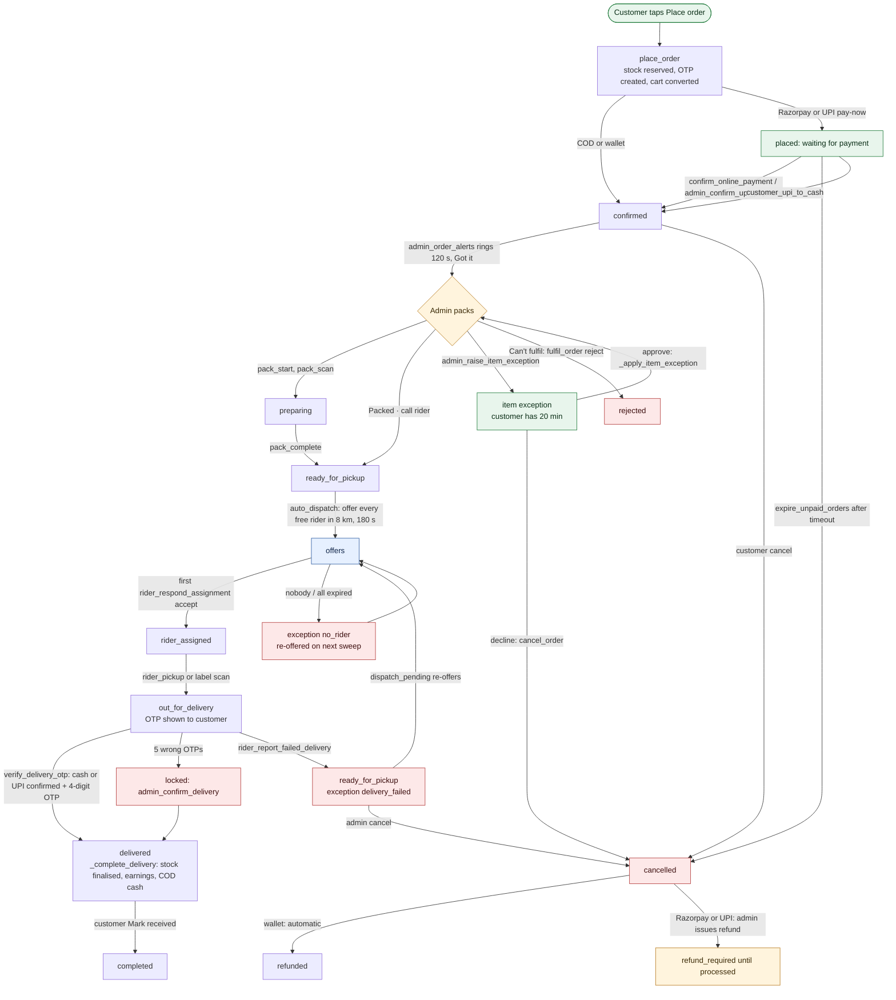

# Merta Deal order flow: audit and recommended flow

Audited 11 November 2026 against the migrations (newest body wins, `supabase/rollout-0049.sql` holds the current `place_order`, `cancel_order`, `fulfil_order`, `_apply_item_exception` and `_complete_delivery`), the app code and the live `settings` rows of the production project. Merta Deal is a single operator: one admin team, one pickup point (setting `pickup_point`: Merta Deal, Gandhi Chowk, Merta City 341510), its own riders. There is no separate "store" role any more (migration 0030).

Production settings that shape the flow today:

| Setting | Live value | Effect |
| --- | --- | --- |
| `auto_accept_orders` | true | COD and wallet orders are confirmed the moment they are placed |
| `order_alert_require_accept` | false | the admin popup rings for the ring window and shows "Got it"; nothing waits for a tap |
| `order_alert_ring_seconds` | 120 | how long a new order rings on admin screens |
| `dispatch_offer_all_riders` | true | a packed order is offered to every free online rider in range; first accept wins |
| `dispatch_radius_km` / `dispatch_offer_timeout_seconds` | 8 / 180 | who is eligible, and how long one offer lives |
| `handover_requires_scan` | false | the rider collects the bag with a tap, no label scan needed |
| `upi_pay_now_enabled` + `upi_id` | true, set | customers can pay to the shop's UPI ID before packing |
| `item_exception_timeout_minutes` | 20 (default) | how long a customer has to answer "item unavailable" |
| `otp_max_attempts` | 5 | wrong delivery OTPs before the order locks |
| `business_hours` | 06:00 to 24:00 | outside this only scheduled orders are accepted |

## 1. The flow as it runs today

Each step names the actor, the database function that does the work, and what the customer sees.

### Step 1. Customer places the order

- **Actor:** customer (signed in, or a guest whose name and phone come from the delivery address).
- **System:** `place_order` locks the cart, validates address, serviceability, minimum order, slot and business hours, writes the order as `placed`, snapshots the address, creates the 4-digit delivery OTP in `order_secrets`, reserves stock for every line through `_order_reserve_stock`, consumes the coupon, and marks the cart `converted` in the same transaction. A duplicate submit finds no cart and fails with `CART_EMPTY`.
- **Payment branches:**

| Method | Order status after placing | Payment status | What happens next |
| --- | --- | --- | --- |
| Cash on delivery | `confirmed` (auto) | `cod_pending` | goes straight to packing |
| Wallet | `confirmed` (auto) | `paid` | balance debited inside `place_order` |
| UPI pay-now | `placed` | `pending`, provider `upi` | order page shows the shop's UPI QR; "I've paid" calls `customer_upi_claim`; an admin confirms under Payments (`admin_confirm_upi_payment`), which marks it paid and confirmed in one step; "Pay cash instead" switches to COD |
| Razorpay (card, net banking, online) | `placed` | `pending`, provider `razorpay` | the browser opens Razorpay; the verify route and the webhook both call `confirm_online_payment`, which marks it paid and auto-confirms |

- **Customer sees:** "Order confirmed, arriving in about N minutes" (COD, wallet) or "Waiting for payment". `promised_at` is fixed here as now plus the zone's maximum ETA, or the slot end for scheduled orders.

### Step 2. The order reaches the shop

- **Actor:** system, then admin.
- **System:** `notify_admins('new_order')`. Every open admin screen polls `admin_order_alerts()` every 30 s and on Realtime changes. That feed also runs the housekeeping sweeps (`dispatch_pending`, `expire_item_exceptions`). The popup rings for 120 s and shows the items with a "Got it" button (`admin_accept_order`, which records who saw it and clears the unattended flag).
- **Scheduled orders** are not held: they ring, auto-confirm and can be packed immediately. The slot shows as a tag.
- **UPI pay-now orders** wait in the feed until an admin marks the payment received or not received.

### Step 3. Accept or reject

- **Actor:** admin.
- **Accept** is automatic for COD and wallet. For online and UPI orders it happens when the payment is confirmed. The "Accept" button only appears for a `placed` order and is disabled while payment is pending.
- **Reject** ("Can't fulfil", `fulfil_order('reject')`): allowed from `placed`, `confirmed` or `preparing`; releases the reservation, withdraws pending item exceptions, flags a refund, sets `rejected`, and the customer is told "Order could not be fulfilled".

### Step 4. Check and pack

- **Actor:** admin (packer).
- **Two ways to pack.** Scan flow at Admin → Scan: "Start packing" (`pack_start` → `preparing`), scan each item (`pack_scan` checks product and size, flags wrong weight or extras), "Complete" (`pack_complete` → `fulfil_order('ready')`). Or the one-tap "Packed · call rider" on the order page, which goes from `confirmed` straight to `ready_for_pickup` without scanning. Packing never changes stock.
- **Item unavailable:** admin raises `admin_raise_item_exception` (unavailable or short). The customer gets 20 minutes to approve the smaller order or decline (which cancels the whole order). Approve runs `_apply_item_exception`: the line shrinks or is removed, only the short quantity is released from the reservation, the bill is recomputed, a wallet refund is instant, any other refund is flagged for the admin. "Packed" is refused while an exception is pending.
- **Customer sees:** "Packing your order" for both `confirmed` and `preparing`, with a cancel button available at `placed` and `confirmed` only.

### Step 5. Rider assignment

- **Actor:** system, with the rider deciding.
- **Trigger:** "Packed" (`fulfil_order('ready')`) calls `auto_dispatch` immediately. Offer-everyone mode inserts an `offered` assignment for every rider who is active, online, has a GPS fix, is within 8 km of Gandhi Chowk, is not on a delivery and has not rejected this order. Each rider's phone rings (`OfferAlert`) with distance, earning and COD amount, for 180 s.
- **First accept wins** (`rider_respond_assignment`): the order becomes `rider_assigned`, the rider's pay is quoted and frozen from the active rate card, the other offers are set to `expired`, a late accept gets `OFFER_TAKEN`. Reject marks that rider's offer `rejected` and re-runs dispatch.
- **Nobody in range:** the order is flagged `no_rider` in the Exceptions tab and admins are notified once per 60 minutes. It is re-offered automatically by `dispatch_pending`, which runs whenever a rider goes online, a rider app polls, an admin screen polls, a rider responds, or an admin taps "Re-run auto-dispatch". There is no server-side timer.
- **Manual assignment:** admin → order page → "Assign rider" (`admin_assign_rider`), allowed at `confirmed`, `preparing` and `ready_for_pickup`.
- **Customer sees:** "Packed · finding a rider", then "Rider is picking up your order" with the rider's name.

### Step 6. Pickup and handover

- **Actor:** rider.
- **System:** "I've reached the pickup point" (`rider_mark_arrived`, admins notified). "Picked up all items" (`rider_pickup`) or a label scan (`rider_scan_pickup`, or the admin's `scan_confirm_dispatch`). Both refuse an order that is not packed (`ready_at` null). The handover method and person are recorded. Order becomes `out_for_delivery`.
- **Customer sees:** "On the way" with a live map (GPS points from `record_rider_location`) and the delivery OTP, revealed on this page only at this status, never by SMS.

### Step 7. Delivery and OTP

- **Actor:** rider, with the customer reading out the OTP.
- **System:** "I've reached the customer" (`rider_mark_arrived`). For COD the rider picks cash or UPI (shop QR) and confirms collection before the OTP box opens. `verify_delivery_otp` checks the code against `order_secrets`; a wrong code counts an attempt, five wrong codes lock the order and the rider is told to call support. The only unlock is `admin_confirm_delivery` with a written reason (recorded in the audit log).
- On success `_complete_delivery`: assignment `delivered`, order `delivered`, reserved stock finalised out of physical stock, `rider_earnings` row with the frozen quote, `cod_collections` row (cash now held by the rider, UPI flagged for admin confirmation), reward points, referral credit, "Order delivered" notification.
- Stores and admins can never set `delivered` except through the support path above.

### Step 8. Completion, cancellation and refunds

- **Completed:** only the customer's "Mark received" tap (`mark_order_completed`). Nothing completes orders automatically, so most stay `delivered`.
- **Customer cancel:** allowed at `placed` and `confirmed` (`cancel_order`). Releases stock, cancels live assignments, withdraws exceptions, hands back a referral credit.
- **Admin cancel:** any status before delivered. A picked-up rider is compensated from the rate card (default 0).
- **Refunds (`_handle_refund_on_cancel`):** wallet is credited instantly and marked `refunded`. For Razorpay and UPI only `payments.refund_required` is set; an admin issues the money from the order page ("Refund via Razorpay" or "Mark refunded manually"), then `mark_refund_processed` records it. A paid order shows "Paid" to the customer until that happens.
- **Failed delivery (`rider_report_failed_delivery`):** customer unreachable, address problem, refused, or other. The assignment is cancelled with the reason, the order goes back to `ready_for_pickup` with `exception = delivery_failed`, stock and payment are untouched, the customer is told "we'll contact you", admins are told to re-dispatch or cancel. The next sweep re-offers it automatically.
- **Unpaid online orders** are cancelled by `expire_unpaid_orders` after 30 minutes (hardcoded in the cron route), but that cron runs once a day on the Hobby plan, so in practice up to 24 hours. A claimed UPI order never expires.

## 2. Gaps, manual steps and mismatches

Ordered by how much they hurt a live order. Each has the evidence from the audit.

### A. Timers only run while someone has an app open

1. **No server-side housekeeping.** Offer expiry and re-dispatch (`dispatch_pending`), item-exception expiry, unattended escalation and unpaid-order expiry all run either inside `admin_order_alerts` / `rider_assignments` polls or in the Vercel crons. Vercel Hobby allows daily crons only, so `vercel.json` schedules notifications, expire-unpaid and wholesale at 03:00 UTC. If no admin or rider screen is open, a packed order sits with stale `offered` rows, an unpaid order holds its stock for a day, and push notifications queue.
2. **Push delivery is client-triggered.** `notify_user` only inserts rows; `deliverPendingPush` runs from the daily cron or when an admin alerts screen or rider offer screen flushes it. Customer pushes ("rider assigned", "out for delivery", "delivered") leave only when a staff screen happens to be open. The cron route also refuses to run without `CRON_SECRET`, which was not set in production at the last check.
3. **Riders never go stale.** `is_online` has no heartbeat and `auto_dispatch` only checks that a GPS fix exists, not its age. A rider who closed the app hours ago still receives offers at an old position.

### B. States an order can get stuck in

4. **Rider assigned before packing.** The order page lets an admin assign a rider at `confirmed`; when the rider accepts, the order becomes `rider_assigned` with `ready_at` null. "Packed" then refuses (needs `confirmed`/`preparing`), scanning refuses, pickup refuses `ORDER_NOT_READY`, and the Packed button is hidden. The only exit is cancelling the order.
5. **No reassignment after accept.** There is no `admin_unassign` or rider cancel. A rider who accepts and never turns up can only be cleared by that rider reporting a failure or by cancelling the order.
6. **Locked OTP has no reset.** Nothing lowers `otp_attempts`; the only exit is `admin_confirm_delivery`, which also records COD as cash even when UPI was taken.
7. **Failed online payment is stranded.** `mark_payment_failed` sets `payment_status = failed` but leaves the order `placed` with stock reserved; `expire_unpaid_orders` only matches `pending`, so it never expires. The order page's "Retry from checkout" link leads to an empty cart (the cart was converted at placement) and there is no "pay this order again" path.
8. **A late payment lands on a cancelled order.** `confirm_online_payment` does not check the order status, so a webhook arriving after expiry marks a cancelled order `paid` with no refund flag.
9. **Claimed UPI orders never expire** and hold their reservation until an admin acts.

### C. Money

10. **Refund copy promises what the code does not do.** The cancel dialog, the rejection notice and the "payment failed" alert all say the money is refunded automatically within 5 to 7 days. Only wallet refunds are automatic; Razorpay and UPI refunds are a manual admin step, and nothing refunds a failed payment because nothing was captured.
11. **Partial refund then cancel loses the remainder.** After an approved exception the payment is `partially_refunded`; `_handle_refund_on_cancel` only handles `paid`, so a later cancel refunds nothing and flags nothing.
12. **`mark_refund_processed` overwrites `refund_amount`** instead of adding, and the Razorpay refund route plus the `refund.processed` webhook can both call it, notifying the customer twice.
13. **Coupons are never restored** on cancel, reject or expiry.
14. **The Razorpay webhook swallows RPC errors** and always answers 200, so Razorpay never retries a failed update, and there is no event-id dedupe.
15. **`payments.status` and `orders.payment_status` drift**: exceptions update one, UPI-on-delivery confirmation updates neither.

### D. What the customer is told

16. **`confirmed` is labelled "Confirmed · packing"** while the order is still cancellable; the dialog says "cancel until packed" but the database blocks cancel at `preparing`, which only the scan flow sets.
17. **A failed delivery looks like a fresh pack.** The order returns to `ready_for_pickup`, the stepper slides back from "On the way" to "Packing", and the customer gets "Order packed & ready, assigning a partner" plus "delivery failed". The tracking page has no failed-delivery state.
18. **Checkout says the OTP "will be shared after the order is placed"**; it appears only when the order is out for delivery.
19. **"Delivered" is described as "handed over after OTP check"** even when support confirmed it without an OTP.
20. **`promised_at` never moves.** It is set at placement, so an order confirmed 10 minutes later by a UPI check shows "Running late" immediately after confirmation. Checkout also hardcodes "20–35 min" for express while settings say otherwise, the OG image says "delivered in 20–25 minutes" and the product meta "usually 20 min" (not target-worded).
21. **Item exceptions do not appear live** on the order page (server-rendered once; Realtime refetches `order_tracking` only), and the database does not enforce the deadline in `customer_resolve_exception`.
22. **Guest orders are orphaned on sign-in**: `merge_guest_cart` moves addresses and the cart, not orders.
23. **The rider's phone is in the tracking payload while the offer is still `offered`**; only the UI hides it. The public `/track` RPC is open to anonymous callers, returns the OTP for order number plus phone, and has no attempt limit.

### E. Store and admin screens

24. **The "New" tab grows without limit** in no-accept mode because `accepted_at` is only set by "Got it". The popup's "All waiting orders" link filters `status=confirmed`, which is not the feed's definition.
25. **Expired item exceptions do not block "Packed"**, nothing auto-resolves them, and the flag `item_exception` survives to delivery. Removing a line with quantity 0 cascades and deletes the exception row itself.
26. **The bill after an exception is only partly recomputed**: coupon discount, delivery fee, tax and rider earning are not re-checked against thresholds.
27. **Scan screen copy is out of date** ("Stock was already deducted when the order was placed"; stock is reserved since 0048).
28. **Scheduled orders are never held**: no lead-time or slot-hours check on the server, they ring and dispatch immediately.
29. **The offer amount can differ from the paid amount**: the popup shows `orders.rider_earning` from settings, the accept freezes `rider_pay_quote` from the rate card.
30. **Admin-assigned offers expire after the column default (3 minutes)**, not `dispatch_offer_timeout_seconds`, and admin "Assign" does not check that the rider is online or in range.
31. **`delivery_failed` is never cleared** by a later successful delivery, and `_set_exception` keeps the first `exception_at` when the kind changes.
32. **Capacity counts unpaid online orders** and also blocks admin wholesale placement.
33. **Hygiene:** `auto_dispatch` is callable by any signed-in user (blanket grant), `admin_accept_order` does not refuse delivered orders, the refund route does not check the provider.

## 3. Recommended simple flow

Keep the database enum (it is already correct and every transition is guarded) and fix the layer the people see. The customer should only ever see five live states plus two end states. Internally, keep `preparing`, `rider_assigned` and `completed` as details.

### Customer-facing statuses

| Customer sees | DB statuses | Meaning | Who acts next | Customer can | Store / admin can | Rider can | Timeout or failure |
| --- | --- | --- | --- | --- | --- | --- | --- |
| **Waiting for payment** | `placed` + payment pending | online or UPI payment not received | customer | pay again, switch to cash, cancel | confirm UPI received / not received, cancel | nothing | `payment_pending_minutes` (setting) → auto-cancel, stock released, "payment not completed" |
| **Confirmed** | `placed` paid/COD, `confirmed` | shop has the order, not packed yet | admin | cancel, answer an item question | start packing, raise item exception, reject | nothing | unattended after `order_alert_escalate_minutes` → admin escalation; item question unanswered after timeout → packer decides and customer is told |
| **Packing** | `preparing` | bag being packed; cancel closed | admin | watch, call shop | scan or tap Packed, reject | nothing | same as above |
| **Finding a rider** | `ready_for_pickup`, `rider_assigned` (before pickup) | packed, offering to riders / rider on the way to the shop | riders, then admin | watch, call shop | re-dispatch, assign, unassign a no-show, cancel | accept, decline, arrive, collect | no rider after `dispatch_no_rider_alert_minutes` → Needs attention; accepted rider no-show after `rider_pickup_sla_minutes` → Needs attention with Unassign |
| **On the way** | `out_for_delivery` | rider has the bag; OTP visible | rider | read OTP, call rider | confirm delivery with reason (support only) | collect cash/UPI, enter OTP, report failed | 5 wrong OTPs → locked → support unlock; failed attempt → **Delivery attempt failed** |
| **Delivery attempt failed** | `ready_for_pickup` + `exception = delivery_failed` | customer unreachable / refused / address | admin | call shop, update address | re-dispatch (same bag), cancel with refund | nothing until re-offered | not re-offered automatically: admin decides |
| **Delivered** | `delivered`, `completed` | handed over | customer (rate) | rate, reorder, open a support ticket | refund if an exception is still open | nothing | auto `completed` after `order_complete_hours` |
| **Cancelled** | `cancelled`, `rejected` | ended early | admin if money is due | reorder | issue refund, mark refunded | nothing | refund queue shows age; the customer status reads "Refund pending" / "Refunded" |

### Branches

- **Online payment success:** webhook or verify marks paid, order confirmed, `promised_at` recomputed from the confirmation time. Duplicate webhooks are no-ops (already paid).
- **Online payment failure:** order stays Waiting for payment with a "Pay again" button that creates a fresh Razorpay order for the same order; after the timeout it auto-cancels. Nothing was captured, so no refund wording.
- **Delayed confirmation (UPI pay-now):** Waiting for payment until the admin confirms; the customer can switch to cash or cancel; a claimed payment is never auto-cancelled but shows in the admin Payments queue with its age. A payment that arrives after cancellation flags a refund.
- **Cash on delivery:** Confirmed immediately; the rider records cash or UPI at the door; UPI taken at the door stays "to confirm" for the admin.
- **Item unavailable:** customer approves the smaller order or declines (cancel). No answer within the timeout: the exception expires and the packer must decide (pack the rest, or withdraw), the order cannot be marked packed while a decision is missing, and the customer is told what was done. Substitution stays out of scope: offer the smaller order, nothing else.
- **Shop rejects or does not respond:** reject releases stock and flags the refund; no response escalates to all admins after the escalation window, and after the recover window (180 min) the order is cancelled automatically with an apology, so a customer never waits all day.
- **Rider unavailable or reassignment:** offers re-run on the server every minute until a rider accepts; an accepted rider who has not arrived within the pickup SLA is shown in Needs attention with "Unassign and re-offer"; the previous rider's offer is marked cancelled, not expired.
- **Customer unreachable, refusal, failed delivery:** the rider reports it with a reason; the order moves to Delivery attempt failed and is **not** re-offered automatically; the admin calls the customer and either re-dispatches (same packed bag) or cancels with the refund path. The customer page shows the reason and the shop's number.
- **Customer cancellation:** allowed while Waiting for payment or Confirmed; from Packing onward only the shop can cancel (the UI says exactly this). Prepaid cancel flags the refund and shows "Refund pending" until the admin processes it.
- **Duplicate requests, webhook retries, network drops:** `place_order` stays idempotent through the cart lock; the client wraps the call so a lost response shows "Check My orders, your order may already be placed" instead of a stuck spinner; the webhook answers 500 on database errors so Razorpay retries, and an `payment_events` table keyed by Razorpay event id makes every retry a no-op.

## 4. Diagram

## 5. Implementation plan

Everything stays behind SECURITY DEFINER functions called with `supabase.rpc`; no app code writes `orders`, `payments` or `delivery_assignments`. Every new threshold is a `settings` row. Migration numbers below are the next free ones (0050 onward).

### Phase 1. Status and copy clarity (app only, no migration)

| Change | Where |
| --- | --- |
| Customer status mapping: `confirmed` → "Confirmed", `preparing` → "Packing", `ready_for_pickup`/`rider_assigned` → "Finding a rider", `ready_for_pickup` with `exception = delivery_failed` → "Delivery attempt failed" with the reason and shop phone; keep `ORDER_FLOW` for staff screens | `src/lib/order-status.ts`, `src/components/shop/order-status.tsx` (`CustomerOrderSteps`), `src/components/shop/order-tracking-view.tsx` (`headline`) |
| Cancel copy: "You can cancel until packing starts" and the refund sentence depends on the method: COD "nothing to refund", wallet "credited now", online "refund issued by Merta Deal within 5 to 7 working days, you will see Refunded here" | `order-tracking-view.tsx` ConfirmDialog, `_handle_refund_on_cancel` text (moved to Phase 2 since it is SQL) |
| Payment status for the customer: show "Refund pending" when `payments.refund_required` and "Refunded" after; never "Paid" on a cancelled order | `order-tracking-view.tsx`, `src/lib/order-status.ts` `PAYMENT_STATUS_LABEL` helper |
| OTP copy on checkout: "You will see a 4-digit code on the tracking page when the rider is on the way" | `src/components/shop/checkout-view.tsx` |
| "Delivered" description: "Handed over to you" (drop the OTP claim) | `order-status.ts` |
| Remove "Retry from checkout" until Phase 2 adds Pay again; show "Pay cash instead" where allowed | `order-tracking-view.tsx` |
| Express ETA from settings instead of the hardcoded "20–35 min"; target wording on the OG image and product meta | `checkout-view.tsx`, `src/app/opengraph-image.tsx`, `src/app/(shop)/p/[slug]/page.tsx` |
| Exceptions appear live: subscribe to `order_exceptions` for the order and call `router.refresh()` | `src/hooks/use-order-realtime.ts`, `order-tracking-view.tsx` |
| Lost-response guard around `placeOrderAction`: on throw, reset `placing`, toast "Your order may already be placed, check My orders", link to `/account/orders` | `checkout-view.tsx`, `src/components/shop/cart-drawer.tsx` |
| Admin "New" tab = orders in the alert feed; the popup link goes to `/admin/orders?status=new` | `src/lib/data/admin.ts`, `src/components/admin/alerts/order-alerts.tsx` |
| Scan copy: "Stock is reserved for this order and finalised on delivery" | `src/components/admin/scan/order-panel.tsx` |
| Rider offer: show "Collect ₹X cash or UPI" and the rate-card quote (`rider_pay_quote`) instead of `orders.rider_earning` | `src/components/rider/offer-alert.tsx`, `offer-card.tsx`; needs `rider_assignments` to expose the quote (small SQL change, Phase 2) |
| Assign rider only when packed: hide "Assign rider" at `confirmed`/`preparing`; the scan panel keeps the same rule | `src/components/admin/order-actions.tsx`, `src/components/admin/scan/order-panel.tsx` |

### Phase 2. Workflow and notifications (migration 0050 `order_flow_hardening`)

1. **Server-side housekeeping.** New `run_order_housekeeping()` (SECURITY DEFINER, service role or admin) that in one call expires stale offers, runs `dispatch_pending`, `expire_item_exceptions`, `escalate_unattended_orders`, `expire_unpaid_orders(get_setting_num('payment_pending_minutes', 30))`, marks riders offline whose `last_location_at` is older than `rider_online_stale_minutes` (default 15), and auto-completes delivered orders older than `order_complete_hours` (default 24). Schedule it inside Supabase with `pg_cron` every minute (no Vercel cron needed for database work), and have it call `/api/cron/notifications` through `pg_net` for push delivery; the Vercel cron stays as a daily fallback. Route: `src/app/api/cron/housekeeping/route.ts` for manual runs. Requires `CRON_SECRET` and VAPID keys in production.
2. **Rider state.** `admin_unassign_rider(p_order_id, p_note)` (allowed at `rider_assigned` and `accepted` assignment: marks the assignment `cancelled` with note, order back to `ready_for_pickup`, re-dispatch); `rider_pickup_sla_minutes` setting feeding a `needs_attention` reason; `admin_assign_rider` restricted to `ready_for_pickup` and to online riders, using `dispatch_offer_timeout_seconds`; `_complete_delivery` clears `orders.exception`. Rider screens unchanged except the quote (above). Functions: `0036` bodies redefined in 0050.
3. **Failed delivery is an admin decision.** `rider_report_failed_delivery` keeps the order at `ready_for_pickup` but `dispatch_pending` and `auto_dispatch` skip orders with `exception = delivery_failed`; "Re-dispatch" in the Needs attention list clears the flag and offers again; the customer notification and `_set_order_status` note say "Delivery attempt failed" rather than "packed again".
4. **Payments.** `confirm_online_payment` refuses a cancelled or rejected order and sets `refund_required` instead; `mark_payment_failed` leaves the order payable and `expire_unpaid_orders` also matches `failed`; new route `POST /api/payments/razorpay/pay-again` (reuses the order route for an existing pending order) and a "Pay again" button; `payment_events(provider, event_id primary key, received_at)` with the webhook inserting first and answering 500 on RPC errors; `mark_refund_processed` accumulates `refund_amount`; `_handle_refund_on_cancel` handles `partially_refunded` and claimed UPI; coupon usage reversed in `cancel_order`, reject and expiry; `promised_at` recomputed inside `_auto_confirm_order` and `admin_confirm_upi_payment`.
5. **Locked OTP.** `admin_reset_delivery_otp(p_order_id, p_reason)` zeroes attempts and regenerates the code (audit row, customer notified); `admin_confirm_delivery` gains `p_upi_collected`.
6. **Item exceptions.** `customer_resolve_exception` enforces `expires_at`; an expired exception blocks "Packed" until `admin_resolve_exception(apply|withdraw)`; `order_exceptions.order_item_id` becomes `on delete set null` with `product_name` snapshotted; `_apply_item_exception` re-checks the coupon minimum and the free-delivery threshold from settings.
7. **Scheduled orders.** `admin_order_alerts` and `dispatch_pending` ignore orders whose `scheduled_slot_start - scheduled_slot_lead_minutes` is in the future; `place_order` enforces lead time, days ahead and slot inside business hours.
8. **Guest orders.** `merge_guest_cart` also moves `orders` whose `user_id` is the anonymous user.
9. **Hygiene.** Revoke `auto_dispatch` from `authenticated` (admin check inside), `admin_accept_order` refuses terminal statuses, the refund route checks `provider = 'razorpay'`, `order_tracking` returns rider phone only from `accepted`, `track_order_by_code` gets a per-phone attempt counter.
10. Harness: `scripts/test-order-flow.mjs` covering every branch above (stuck states, unassign, failed delivery not auto-offered, late payment on cancelled order, pay again, OTP reset, housekeeping idempotency), plus the existing lifecycle, fulfilment, alerts, inventory and UPI harnesses.

### Phase 3. Operations

1. **Needs attention board** (`/admin/attention`, one list in `ADMIN_NAV_DAILY`) fed by `admin_needs_attention()`: unattended, waiting-for-payment older than N minutes, UPI claims to confirm, exceptions expired, no rider, rider no-show, delivery failed, locked OTP, refunds due with age, stale online riders. Each row carries its one next action (`admin_accept_order`, `admin_confirm_upi_payment`, `admin_resolve_exception`, `auto_dispatch`, `admin_unassign_rider`, `admin_reset_delivery_otp`, refund).
2. **Refund queue with age and total** on Admin → Payments; "Refunded" push to the customer when processed.
3. **Rider health**: last GPS age and current offer on Admin → Riders; auto-offline visible.
4. **Flow metrics** (`admin_flow_report`): placed→packed, packed→accepted, accepted→picked, picked→delivered medians per day, failed-attempt and cancel rates, offer acceptance rate per rider; all from `order_status_history` and `delivery_assignments`.

### Not code

- Upgrade the Twilio account so login OTPs reach every number (trial sends only to verified numbers).
- Set `CRON_SECRET` and the VAPID keys in Vercel so cron routes and push can run; or move the timer to `pg_cron` as in Phase 2.
- Decide the `payment_pending_minutes`, `rider_online_stale_minutes`, `rider_pickup_sla_minutes` and `order_complete_hours` values in Admin → Settings once Phase 2 lands.

## 6. Implemented on 11 November 2026 (migration 0050)

The two follow-up briefs (admin list not updating, rider flow reliability and PWA) were implemented the same day. What changed:

- **Admin order list is live.** Root cause: `/admin/orders` is a Server Component with no Realtime subscription and no poll; only the alert popup subscribed, and it refreshed the page only after "Got it" or a UPI confirmation. New `LiveList` (kit) subscribes to `orders` and `delivery_assignments`, debounces into one `router.refresh()`, polls every 30 s while disconnected, refetches on reconnect, on tab return and when the network returns, reconciles every 2 minutes while live, and shows Live / Connecting / "Live updates unavailable". Filters, pagination and the open quick view stay as they are; rows cannot duplicate because the server renders them.
- **Rider answers are safe to retry** (`rider_respond_assignment`): a repeated accept or decline reports `already: true`; a late accept on an order another rider took returns `OFFER_TAKEN`; an expired offer returns `OFFER_EXPIRED`. Two riders tapping at the same moment: the row lock plus the unique live-assignment index let exactly one accept through; the other gets `OFFER_TAKEN` and its offer closes. The database decides; the app never shows an acceptance before the server confirms it.
- **Offers no longer wait for an open app.** `dispatch_pending()` now expires stale offers and sets quiet riders offline first; `run_order_housekeeping()` bundles that with exception expiry, unattended escalation and unpaid-order expiry (new setting `payment_pending_minutes`), and migration 0050 schedules it every minute with pg_cron. `/api/cron/housekeeping` is the fallback.
- **A rider who goes offline hands offers back at once**; a rider whose app has been quiet for `rider_online_stale_minutes` (default 30, never mid-delivery) is set offline and told.
- **No more stuck orders:** a rider can only be hand-assigned to a packed order; `admin_unassign_rider` frees an accepted no-show and re-offers; accepting clears `no_rider` / `delivery_failed`; a delivered order never keeps a dispatch flag.
- **Rider PWA:** own manifest (`/rider.webmanifest`, scope `/rider`, "MD Rider"), install card on the profile tab that reports the browser's real install state, offline banner, a short vibration on a new request where the browser allows it. The service worker still caches only the shell and static assets; no order, address or phone data is ever cached.
- Harness `scripts/test-dispatch.mjs` (43 checks) plus updated alerts and scan harnesses.

Still manual or outside the code: paste `supabase/rollout-0049.sql` then `supabase/rollout-0050.sql` in the Supabase SQL editor; set `CRON_SECRET` and the VAPID keys in Vercel for push delivery; the refund, OTP-reset, pay-again and scheduled-order items in section 5 are not yet built.

## 8. Rider journey and live updates (12 November 2026, migration 0051)

**Rider app.** The home screen is three things in order: the online switch, the one thing to do now, and today's numbers (active, delivered, earned, plus a cash-to-hand-over line when it is above zero). A delivery request is one card, the ringing popup, with pickup point and area, delivery area, earnings and distance only when real, cash to collect or "Prepaid", the expiry countdown and large Accept / Decline. Accept reports success only after `rider_respond_assignment` confirms; the answers "another rider got it" (`OFFER_TAKEN`), "expired" (`OFFER_EXPIRED`, re-offered by the server) and "no longer open" (withdrawn or cancelled) each get their own message and refresh the rider's work. A lost response is retried safely (`already: true`). The active delivery is a four-step journey that follows the assignment status: Go to pickup and Collect the order while `accepted` (the split is `arrived_pickup_at`, written by `rider_mark_arrived`), Go to customer and Complete with OTP while `picked_up` (`arrived_customer_at`). Only the current step's primary action shows; the map is folded until asked for; the promised-by time is the only ETA because no other real ETA exists. Delivery still completes only through `verify_delivery_otp`.

**Honest states.** The top bar shows the connection (Live, Connecting, Reconnecting, No internet) and the GPS fix age; a fix older than 30 s reads "GPS stale", never "live". Location blocked, no GPS, offline, pending approval and suspended each have an explicit banner. Push and background GPS are described as they are: the request rings while the app is open; a closed browser gets a push only once VAPID keys are set on the server.

**Notifications.** `_notify_rider_offer` keeps one `delivery_offer` row per rider and order: a re-offer (expiry sweep, admin assignment, a rider coming back online) refreshes that row, marks it unread and re-queues its push, and counts the offers in `data.offers`. The profile list groups rows by type and order with a ×n count.

**Live updates.** The rider shell's Realtime channel (this rider's `delivery_assignments` and own `delivery_partners` row) now reconciles once on reconnect, on tab resume and when the network returns; the home and the popup poll only while Realtime is down (20 s) with a slow reconcile while live. The admin shell gained `LiveCounts`: order inserts and status changes refresh the nav badges and the current page on every admin page, through one shared timer with the orders list so an event never costs two refreshes. Order detail (admin) and customer tracking (`useOrderRealtime`) refetch on reconnect, resume and online, and poll only while disconnected.

**Not changed.** Who may accept (first accept wins), who may deliver (OTP only), stock, money. No background GPS, no continuous ringing with the phone locked: both need the native wrapper.

## 7. Verification used for this audit

Read-only. Production settings and counts came from the live database (orders by status, assignment statuses, exception flags, notification types over 30 days). No order, payment or rider row was changed. Nothing in this document was taken from the public website alone.
